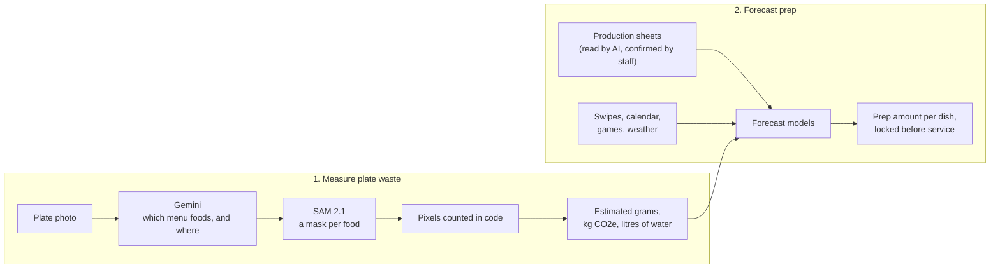

# ScrapSaver

**Measuring and forecasting dining hall food waste at the University of Michigan.**

ScrapSaver measures the food students leave on their plates from a single overhead photo, and uses that measurement to test whether a dining hall could prepare closer to what diners actually eat. It is built around Michigan Dining (M-Dining) by **Shaan Barai, Angad Chauhan, Michael Wu and River Tompkins**, and is an ongoing research prototype.

> **Status (November 2026)**
> - **Plate-waste detection** runs on real dining hall photos. [Measured results below](#results).
> - **Weight estimation** has been tested against a scale on a public dataset (full plates, not leftovers).
> - **Forecasting** runs end to end, but **every forecasting number so far is simulated**. A shadow pilot on real M-Dining data is next.

Every result in this README says whether it comes from **real photos**, a **public dataset** or **simulated data**, and links to the page that says exactly what was measured.

---

## Contents

- [The problem](#the-problem)
- [How it works](#how-it-works)
- [Results](#results)
- [Research design choices](#research-design-choices)
- [Limitations](#limitations)
- [Roadmap](#roadmap)
- [Repository layout](#repository-layout)
- [Getting started](#getting-started)
- [Testing](#testing)
- [Documentation](#documentation)
- [Credits](#credits)

---

## The problem

Before every meal, a dining hall decides how much of each dish to cook:
- **Too little,** and the dish runs out halfway through service.
- **Too much,** and the extra is thrown away, along with its cost and environmental footprint.

At a large Michigan dining hall, that decision is made for roughly 1,000–1,400 diners per meal. It's planned with forecasts from the hall's food-service software (FSS), on a six-week menu cycle. In interviews, dining hall staff described a measurement gap:

- **What happens in the kitchen is recorded by hand.** Each station writes down how much was prepared, how much was left in the pan, and when a dish ran out. A manager collects the sheets the next morning.
- **What happens on the plate isn't recorded at all.** Compost bins aren't weighed per dish, and diners often take a full plate and throw away the sides.
- **Demand swings** with weather, football games, exams, holidays and trends, and kitchens are often short-staffed.

Without a per-dish record of what comes back on plates, there's no number to plan against, and no way to tell whether a change in prep actually reduced waste.

## How it works

ScrapSaver has two halves: it **measures** waste bottom-up from plates, and it **forecasts** prep top-down from kitchen records.



### 1. Measuring plate waste

1. **Classify against the menu.** Gemini (`gemini-3.8-flash`) looks at the plate photo and chooses only among *that meal's* menu items. It returns a box around each piece of food and marks which plate is being scanned, so food on neighbouring trays isn't counted. Two passes run at the same time, and their boxes are merged.
2. **Segment.** SAM 2.1 (`sam2.1-hiera-small`) turns each box into a pixel-precise mask. Where masks overlap, the smallest box wins, and tiny fragments under 1% are dropped.
3. **Count.** Pixels of leftover food are counted per dish, in code. **Pixels wasted is the stored measurement**; everything after it is a labeled estimate.
4. **Estimate impact.** With a camera calibration, pixels become cm², and cm² become grams through each food's grams-per-cm² factor. Grams then become estimated kg CO2e and litres of water. The dashboard ranks foods with a Waste Impact Score that prices these at $0.19 per kg CO2e and $1.50 per m³ of water ([factors/README.md](factors/README.md)).

### 2. Forecasting how much to prepare

For each dish at each meal:

```text
prepped = eaten + tray waste + pan leftover
```

- **Inputs:**
  - **Prepped and pan leftover** come from the kitchen's handwritten production sheets. Gemini reads a photo of the sheet into draft rows, and a staff member confirms each one.
  - **Tray waste** comes from the plate photos.
  - **Demand context:** meal swipes, the academic calendar, home football games, religious holidays and day-ahead weather forecasts.
- **Models.** Five forecasters sit behind one interface: the baseline, seasonal naive, a 4-week moving average, exponential smoothing and gradient boosting. Optional unsupervised helpers (day-type clustering, an anomaly flag on sheet entries) are off by default.
- **From forecast to prep amount.** Each dish gets a prep amount that balances the cost of running out against the cost of waste. The waste cost includes the environmental price above, so high-impact dishes get a slightly smaller buffer.
- **Shadow mode.** During a pilot, the hall keeps cooking from FSS exactly as it does today. ScrapSaver writes its forecast before each meal, and the database locks it once service starts. Afterwards it's scored against FSS and against what actually happened.

Full method: [docs/forecasting-methods.md](docs/forecasting-methods.md).

---

## Results

### Detection: which menu foods are on the plate (real photos)

12 real plate photos from one dinner at one dining hall, with 18 foods hand-labeled by the team. Each detected food is compared with the label: **recall** = share of the foods on the plate that were found; **precision** = share of reported foods that are really there.

| Menu offered to Gemini | Runs | Correct | Missed | Wrong | Recall | Precision |
|---|---|---|---|---|---|---|
| **That dinner's 23-food menu** | 1 | 17 | 1 | 1 | **94.4%** | **94.4%** |
| A 26-food test menu (3 extra foods) | 3, identical | 17 | 1 | 4 | 94.4% | 81.0% |

- **Settings:** fixed seed, temperature 0.
- **The single miss was a timeout.** Gemini "thought" for about 28,700 tokens on one photo and never answered. A fix (retry with thinking capped at 1,024 tokens) found the missing food in a single test request. Its effect on the full 12-photo run is **projected, not yet measured.**
- **The one "wrong" detection** (rice on IMG_2703) also appeared in an earlier experiment and may be a gap in the hand label. It's being checked.
- **Why the menu matters:** offering foods that weren't served that night causes confusions (Cheese Bread for Pepperoni Pizza, for example). In production, each photo is classified against its own meal's menu.
- **Not yet scored:** how accurate the masks' outlines are.

Details: [docs/detection-accuracy.md](docs/detection-accuracy.md).

### Speed (real photos)

| Seconds per plate | Average | Median | Fastest | Slowest |
|---|---|---|---|---|
| Gemini pass 1 | 21.7 | 18.8 | 8.3 | 63.1 |
| Gemini pass 2 | 33.3 | 37.7 | 11.3 | 49.0 |
| SAM 2.1 | 0.5 | 0.5 | 0.3 | 0.7 |
| **Total** | **34.7** | **38.4** | **14.9** | **50.0** |

- Measured on 11 of the 12 photos; the 12th is the timeout above.
- The two Gemini passes run in parallel, so the total is about the slower pass.
- Time grows with how long Gemini thinks, not with the number of foods.

### Weight: grams from area (public dataset)

To check whether area-based weight estimates hold up, we used **Nutrition5k** (Google, CVPR 2021): overhead photos of cafeteria plates from a known camera height, with every ingredient weighed on a scale.
- **Test set:** 31 single-food plates covering 7 food types.
- **Measured factors:** fitted on 27 other plates.

| Grams estimated from | Mean abs. error | Mean abs. % error | Bias (avg. over/under) | Without leafy greens: error / % error |
|---|---|---|---|---|
| Area × our original per-food factors | 35.8 g | 45% | −1.6 g | 35.9 g / 37% |
| **Area × factors measured on Nutrition5k** | **20.4 g** | **33%** | +5.4 g | **18.9 g / 22%** |
| Depth (volume) × measured density | 24.7 g | 38% | +0.9 g | 22.6 g / 26% |

What this shows:
- **The original per-food factors are the weak point.** Per food they were off by −56% to +53%. Their near-zero overall bias comes from errors cancelling out, not from accuracy.
- **Measured factors roughly halve the error.**
- **Depth didn't beat area overall.** It only did better on cauliflower, so the pipeline stays area-based for now.
- **Leafy greens failed every method,** but only 2 test plates were greens.

Caveats:
- These are **full plates, not leftovers.**
- They weren't taken with our camera.
- The masks were a stand-in (colour + depth boxes → SAM), because the Gemini API was unavailable during this test.
- 12 of 70 sampled plates, mostly bowls, were excluded for clearly wrong masks before any error was computed.
- There is an unresolved 1.76× disagreement between two published pixel-scale figures for this camera. It affects the original-factor row, not the measured ones.

Details and limits: [docs/weight-accuracy.md](docs/weight-accuracy.md).

### Forecasting (simulated)

All forecasting results so far come from a **made-up hall**: 6 weeks, lunch and dinner, 15 dishes, 291 dish-meals. On it, the five models land between 18.3% and 22.3% WAPE.

These numbers show that the method runs end to end, with walk-forward evaluation and matched-stockout comparisons. **They are not evidence about any real dining hall or about FSS.** The "FSS" in the simulation was built to over-prepare, so beating it means nothing.

Details: [docs/forecasting-methods.md §8](docs/forecasting-methods.md#8-results-so-far).

---

## Research design choices

Decisions made so the results can be trusted, not just demoed:

- **Pixels are the stored measurement.** Grams, CO2e and water are always labeled estimates, computed at read time. They're blank, never zero, without a calibration, so a weak assumption can't silently become data.
- **Menu-first classification.** Gemini picks only from the meal's menu, which is how a dining hall actually works. The test above shows why it matters.
- **Deterministic evaluation.** Fixed seed and temperature 0, with repeated runs, separate real model changes from noise.
- **Censored demand.** When a dish runs out, observed demand is only a lower bound. Those meals are treated as "at least this much," never as the true demand.
- **No look-ahead.** Backtests are walk-forward. A test fails if any feature uses future data, including the *observed* weather on the day being predicted: models only see the forecast available the day before.
- **Fair comparison.** Models are compared with FSS at the **same number of stockouts**, so a model can't "win" just by cooking less and running out more.
- **Locked shadow forecasts.** Once service starts, the database rejects any change to that meal's forecast.
- **Simulated data is labeled everywhere:** in the database (`is_simulated`), the UI, the API and the docs.
- **Privacy.** Production-sheet reviewer names are private, readable only by the server, and never shown in the dashboard. Photos show plates, not people.

## Limitations

- **Detection test:** 12 photos from one dinner, labeled by the team, scored in one run. Mask outlines aren't yet scored against hand-drawn masks.
- **Weight:** checked on full lab plates, not leftovers, and not with our camera. The dining hall camera hasn't been calibrated yet, and bowls are untested.
- **Forecasting:** there's no real M-Dining data yet. Production sheets, an FSS export and swipe counts have been requested ([docs/data-intake.md](docs/data-intake.md)).
- **Model dependence:** detection depends on a hosted model (Gemini). Results are pinned to `gemini-3.8-flash` and may change with model updates.

## Roadmap

1. Measure the timeout fix on all 12 photos, and test capping Gemini's thinking on every request (speed and cost per plate).
2. Re-run the weight test with the real Gemini → SAM pipeline, including multi-food plates and bowls.
3. Calibrate the dining hall camera ([docs/camera-calibration-checklist.md](docs/camera-calibration-checklist.md)), then weigh real leftovers to measure leftover-specific error.
4. Score mask outlines against hand-drawn masks.
5. Run a 6-week shadow pilot at one dining hall ([docs/pilot-runbook.md](docs/pilot-runbook.md)): ScrapSaver's locked forecasts vs. FSS vs. actuals, at matched stockouts.

---

## Repository layout

| Directory | Contents |
|---|---|
| `vision/` | Gemini classification, SAM 2.1 segmentation worker (`vision/sam/`), mask pixel counting, production-sheet reader |
| `backend/` | API, Supabase repository and storage adapters, ingestion and orchestration |
| `frontend/` | Dashboard (React + Tailwind): waste, statistics, production sheets, forecast |
| `analytics/` | Aggregates, calibration and plate-scale estimates, impact formulas |
| `forecast/` | Python forecasting: models, walk-forward backtests, worker, prep sheets, importers for M-Dining data, shadow report, simulated dataset |
| `capture/` | Camera adapter (Arduino UNO Q + Logitech C920s over SSH) and replay tools |
| `supabase/` | Postgres schema, row-level security and storage bucket, as migrations |
| `factors/` | Per-food waste, impact and nutrition factor tables, plus the impact formula |
| `data/`, `db/` | Menu parsing and validation; the legacy SpacetimeDB schema |
| `contracts/` | Shared types, error format, sample records and [recorded decisions](contracts/decisions.md) |
| `tests/` | Integration, live, system, detection-scoring and weight-accuracy tests |
| `docs/` | Methods, results, runbooks and plans |
| `deploy/` | Local production stack and the read-only public server |
| `test2/`, `demo_pictures/`, `upload_demo/` | Test plate photos, pipeline walkthrough images, upload demo |
| `archive/`, `experiments/` | Superseded prototypes and one-off experiments (not used at runtime) |

Root: `demo.py` (narrated end-to-end demo) and `test-all.sh` (every test).

## Getting started

**Requirements:** Node.js 20.12+, Python 3.11+ with a virtualenv for SAM 2.1 (see [vision/sam/README.md](vision/sam/README.md)), a Supabase project, and a Gemini API key.

**1. Environment.** Copy `.env.example` to `.env` at the repo root and fill it in. **Never commit `.env`.**

| Variable | Used by | Notes |
|---|---|---|
| `SUPABASE_URL` | backend, workers, dashboard build | The API address, `https://<project-ref>.supabase.co` |
| `SUPABASE_ANON_KEY` | dashboard build | Publishable key; row-level security limits it to dashboard tables |
| `SUPABASE_SERVICE_ROLE_KEY` | backend, workers, scripts | Secret key, **server only**. The dashboard build refuses it. |
| `SUPABASE_DB_URL` | migrations | Session pooler connection string |
| `DATABASE_PROVIDER=supabase` | backend | |
| `OBJECT_STORAGE_PROVIDER=supabase`, `OBJECT_STORAGE_CONTAINER=scrap-images` | backend | Private bucket with signed URLs |
| `GEMINI_API_KEY`, `GEMINI_MODEL` | backend, vision | Live classification and sheet reading |

**2. Run it.**

```bash
set -a; . ./.env; set +a

# Database schema, row-level security and storage bucket (review the dry run first)
npx supabase db push --db-url "$SUPABASE_DB_URL" --dry-run
npx supabase db push --db-url "$SUPABASE_DB_URL"

# SAM 2.1 worker (http://127.0.0.1:8790)
.venv/bin/python vision/sam/worker.py

# Backend API (http://localhost:8787)
cd backend && npm ci && npm start

# Dashboard (http://localhost:5173)
cd frontend && npm ci && npm run dev
```

**3. Forecasting.**

```bash
python3 -m forecast.worker run --hall hall-main --start 2026-10-25 --end 2026-10-31   # write forecasts
python3 -m forecast.backtest --hall hall-main --start 2026-09-26 --end 2026-10-23    # walk-forward model comparison
python3 -m forecast.shadow_report --hall hall-main --start 2026-11-02 --end 2026-11-08  # locked forecasts vs. FSS vs. actuals
python3 -m forecast.prep_sheet --hall hall-main --date 2026-10-25                     # printable prep sheets
```

Until real data arrives, `python3 -m forecast.simulate generate --hall hall-main` creates the labeled simulated dataset. `python3 -m forecast.simulate remove --hall hall-main` deletes only simulated rows. Importers for real swipe counts, FSS exports and production-sheet photos are in `forecast/importers/` ([docs/data-intake.md](docs/data-intake.md)).

**4. Camera calibration** (turns pixels into cm²): place a card of known area where the plates go, with the camera locked, then run `npm run calibrate -- --known-area-cm2 46.21` in `capture/`. See [docs/calibration.md](docs/calibration.md) and the [step-by-step checklist](docs/camera-calibration-checklist.md).

The forecast scheduler (a GitHub Actions workflow that writes forecasts before each meal) is included but **off**; see [docs/scheduler-setup.md](docs/scheduler-setup.md).

<details>
<summary><b>Demo and legacy stack (SpacetimeDB + Cloudflare R2)</b></summary>

The project began on SpacetimeDB (records) and Cloudflare R2 (images) and has moved to Supabase. The legacy stack is kept until its removal is approved; see [docs/supabase-migration-plan.md](docs/supabase-migration-plan.md).

`demo.py` still runs on the legacy stack. It takes a photo with the camera (or replays `test2/` photos), sends it through Gemini and SAM 2.1, and narrates every step:

```bash
python3 demo.py                  # real camera
python3 demo.py --simulate       # no camera: replay test2/ photos (labeled)
python3 demo.py --list           # list the steps
```

Upload demo: `node upload_demo/server.mjs`, then open http://localhost:8795 ([upload_demo/README.md](upload_demo/README.md)). A read-only public version of the dashboard runs at [scrapsaver.app](https://scrapsaver.app) ([docs/deploy-server.md](docs/deploy-server.md)).

Legacy setup steps (SpacetimeDB CLI 2.10.x, R2 bucket and credentials) are in [docs/environment-setup.md](docs/environment-setup.md) and [docs/EXPLAIN.md](docs/EXPLAIN.md).

</details>

## Testing

```bash
./test-all.sh            # everything offline: every package, the dashboard build, Python, forecasting, weight suite
./test-all.sh --live     # also starts the local stack: smoke test and live end-to-end suites (test halls only)
./test-all.sh --list     # list suites; --only a,b / --skip a,b
```

Live checks against Supabase, detection scoring, and the camera test are described in [docs/testing.md](docs/testing.md) and [docs/runbook.md](docs/runbook.md). Live detection runs use Gemini and count toward its API usage.

## Documentation

| Topic | Document |
|---|---|
| Detection accuracy and timing | [docs/detection-accuracy.md](docs/detection-accuracy.md) |
| Weight accuracy (Nutrition5k) | [docs/weight-accuracy.md](docs/weight-accuracy.md) |
| Forecasting methods and results | [docs/forecasting-methods.md](docs/forecasting-methods.md) |
| Camera calibration | [docs/calibration.md](docs/calibration.md), [checklist](docs/camera-calibration-checklist.md) |
| Data requested from M-Dining | [docs/data-intake.md](docs/data-intake.md) |
| Pilot plan | [docs/pilot-runbook.md](docs/pilot-runbook.md) |
| Known limitations | [docs/known-limitations.md](docs/known-limitations.md) |
| Impact formula and food factors | [factors/README.md](factors/README.md) |
| Development log | [docs/PROGRESS.md](docs/PROGRESS.md) |

## Credits

- **Team:** Shaan Barai, Angad Chauhan, Michael Wu, River Tompkins.
- **Thanks** to the Michigan Dining staff who explained how their kitchens plan, record and handle waste.
- **Models:**
  - **Gemini API** (Google), under the [Gemini API Terms](https://ai.google.dev/gemini-api/terms).
  - **SAM 2.1** (Meta AI), code and checkpoints under Apache 2.0, [github.com/facebookresearch/sam2](https://github.com/facebookresearch/sam2).
- **Data:**
  - **Nutrition5k** (Thames et al., CVPR 2021, Google Research), [CC BY 4.0](https://creativecommons.org/licenses/by/4.0/), [github.com/google-research-datasets/Nutrition5k](https://github.com/google-research-datasets/Nutrition5k).
  - **Open-Meteo** weather data, [CC BY 4.0](https://open-meteo.com/en/terms).
  - **Calendar context:** the University of Michigan Registrar's academic calendar, the MGoBlue football schedule, Hebcal and Aladhan.
